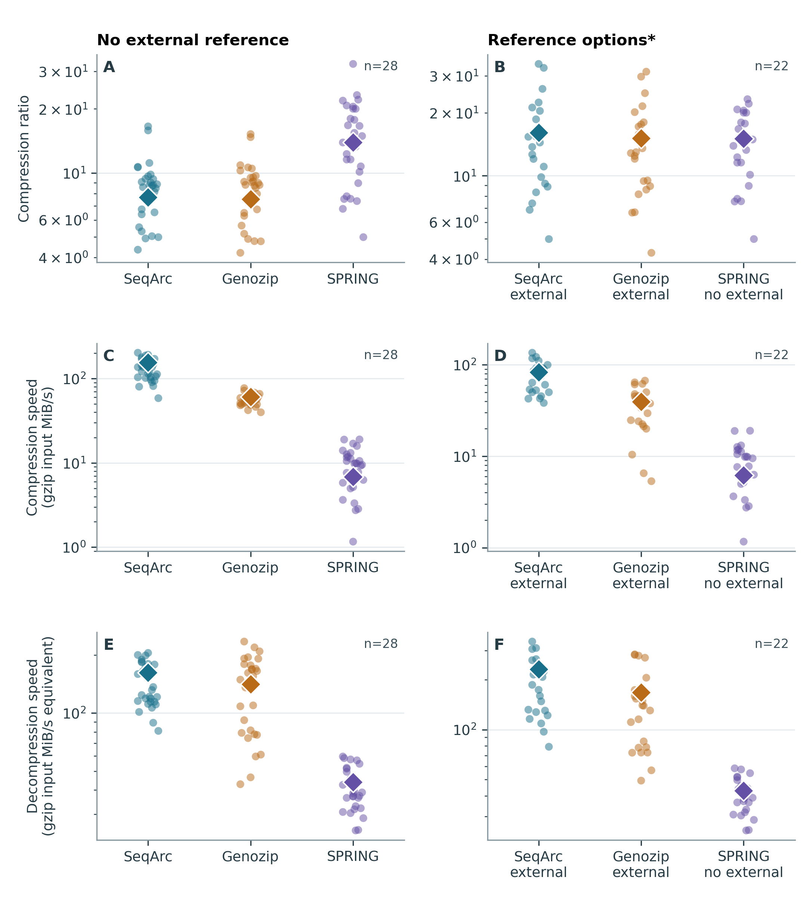
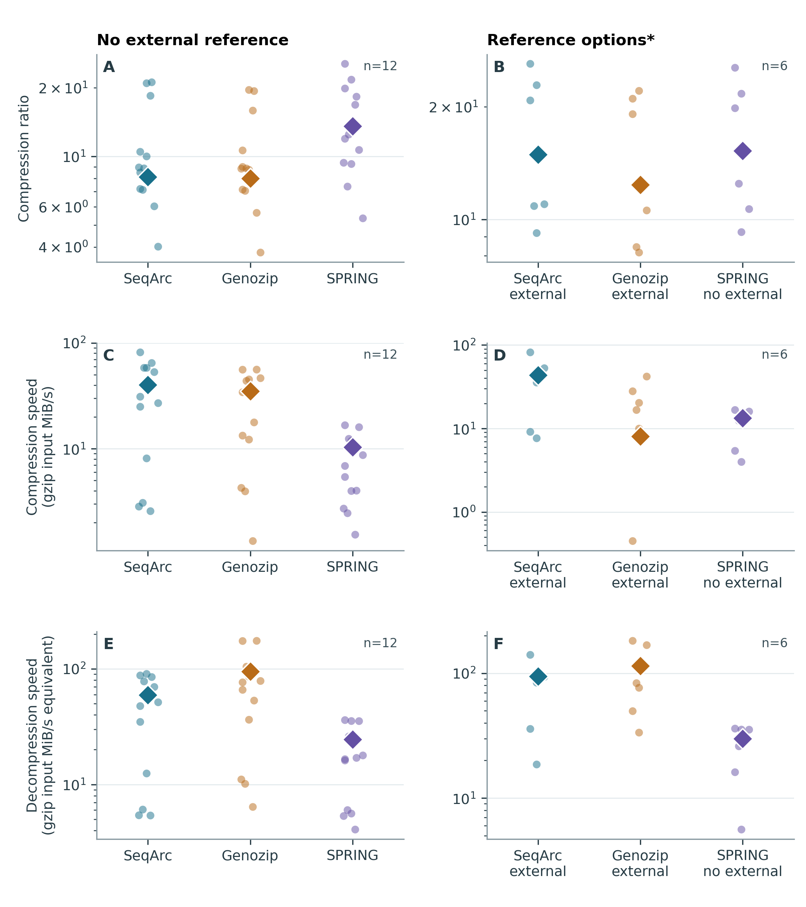
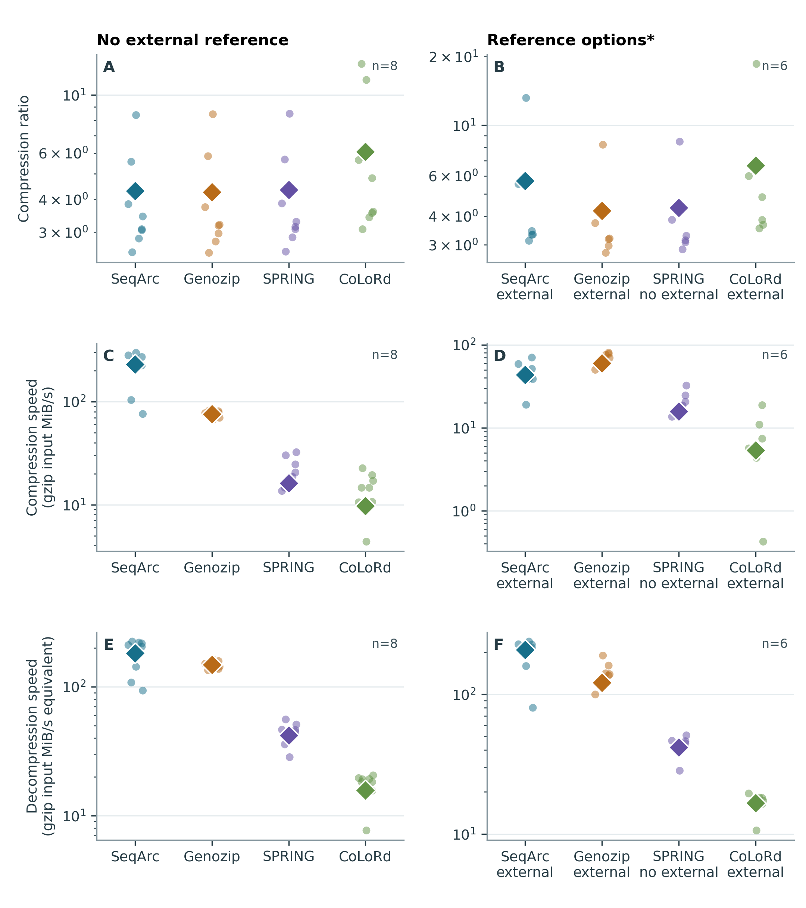

# SeqArc: fast and compact FASTQ archiving

SeqArc is a lossless FASTQ compressor for short- and long-read sequencing data, with optional reference-based compression. It combines fast compression and decompression with storage savings across a broad range of sequencing workloads.

This repository brings together **the benchmark dataset, SeqArc's measured performance, and runnable decompression examples**. You can inspect the inputs and results, download example archives, and restore complete FASTQ files using the supplied decompressor.

[Dataset](#benchmark-dataset) · [Performance](#benchmark-results) · [Full results and logs](#benchmark-materials) · [Try SeqArc](#try-a-small-example)

## Benchmark dataset

The collection contains **52 datasets, 91 gzip FASTQ files and 8 sequencing technology groups**, totaling **1,250.62 GiB** of prepared gzip input. Each dataset is a complete deposited run or declared public vendor output, with both mates retained where applicable.

Selection considered accumulated public-archive holdings, recent releases, and research and sequencing-service applications. It covers variation in technology, organism, assay, read structure, quality representation and natural file size. Small datasets were retained when they represented the selected application, and are reported separately so their performance remains visible.

| Input group | Datasets | Gzip FASTQ files | Gzip input (GiB) |
| --- | ---: | ---: | ---: |
| Smaller short reads: <0.5 GiB per file | 12 | 23 | 3.09 |
| Larger short reads: ≥0.5 GiB per file | 31 | 59 | 887.03 |
| Long reads | 9 | 9 | 360.50 |
| **Total** | **52** | **91** | **1,250.62** |

The short-read size groups use mean gzip size per file, averaging paired mates. The 91 benchmark files include FASTQ exported from 1 public BAM source.

**Technologies:** Illumina (31 datasets), DNBSEQ (9), Oxford Nanopore (5), PacBio (3), CycloneSEQ (1), Ion Torrent (1), Element AVITI (1) and Ultima UG100 (1).

**Workloads and biological material include:**

- **Human sequencing:** 23 datasets spanning whole genomes, exomes, targeted assays, bulk and small RNA, single-cell, spatial and chromatin libraries.
- **Model organisms, agriculture and biotechnology:** mouse and Arabidopsis; maize, quinoa, wheat, potato, rice and spruce; pig, chicken and whiteleg shrimp; and Chinese hamster ovary (CHO) cells.
- **Microbial, viral and community sequencing:** E. coli, yeast and tuberculosis isolates; SARS-CoV-2; fungal ITS and bacterial 16S libraries; freshwater environmental DNA; and food, soil and human-gut communities.

The [dataset catalogue](benchmark/dataset/datasets.tsv) records each input's identity, assay and inclusion rationale. The [coverage table](benchmark/dataset/coverage.tsv) maps inputs to 16 overlapping application categories. [File records](benchmark/dataset/files.tsv) provide public download URLs and preparation details; [reference assignments](benchmark/dataset/references_used.tsv) identify the assemblies used in the benchmark.

## Benchmark results

**SeqArc passed full-file validation in all 52 reference-free and 43 reference-based tests.** Validation checked the complete reconstructed FASTQ byte count and content digest, including both mates of paired datasets.

The main findings were:

- **Larger short reads:** with an external reference, SeqArc produced the smallest total archive and had the shortest total compression and decompression times in the common 22-dataset comparison. Relative to reference-based Genozip 13.0.8, compressed size was **5.8% smaller**, compression was **2.11× faster**, decompression was **1.38× faster**, and compression CPU time was **45.8% lower**. Without an external reference, SeqArc was also fastest at both stages on the common 28 datasets, while SPRING achieved the highest compression ratio.
- **Smaller short reads:** SeqArc compressed fastest in both comparisons. Genozip decompressed fastest; SPRING produced the smallest archives, with reference-based SeqArc close to SPRING in compressed size.
- **Long reads:** reference-free SeqArc compressed and decompressed fastest on the common 8 datasets. With external references, SeqArc decompressed fastest on the common 6 datasets, while Genozip compressed fastest. CoLoRd produced the smallest long-read archives in both comparisons.

Comparisons use the same successfully validated inputs for every tool within each panel. Tests requested 16 threads where supported; see the [experimental protocol](benchmark/README.md) for software versions and execution details. External-reference preparation and storage are excluded. SPRING receives no external reference in either column.

### Performance across datasets

Higher compression ratios and throughput are better. Compression ratio is uncompressed FASTQ bytes divided by archive bytes; throughput in both stages uses prepared gzip input MiB per elapsed second. Circles show individual datasets and diamonds show ratios of summed bytes and times. Vertical axes are logarithmic. Left and right columns use different validated input sets, so they are not before-and-after measurements of adding a reference.



**Larger short reads:** no external reference (left, 28 datasets); external-reference SeqArc and Genozip alongside reference-free SPRING (right, 22 datasets).

<details>
<summary>View the smaller short-read results figure</summary>



**Smaller short reads:** no external reference (left, 12 datasets); external-reference SeqArc and Genozip alongside reference-free SPRING (right, 6 datasets).

</details>

<details>
<summary>View the long-read results figure</summary>



**Long reads:** no external reference (left, 8 datasets); external-reference SeqArc, Genozip and CoLoRd alongside reference-free SPRING (right, 6 datasets).

</details>

See the [benchmark report](benchmark/REPORT.md) for all 6 detailed comparison tables, absolute sizes and times, throughput and memory. The [experimental protocol and outcomes](benchmark/README.md) document validation, timeouts and unsuccessful tests.

## Benchmark materials

- [Dataset catalogue and public inputs](benchmark/dataset/README.md): 52 datasets, 91 prepared gzip FASTQ files, 8 technology groups, selection rationale and reference assignments actually used.
- [Performance report](benchmark/REPORT.md): absolute compression ratios, times, throughput and memory across the six comparison panels.
- [Experimental protocol and results](benchmark/README.md): evaluated software, machine, commands, validation rules, the 259 reported outcomes and unsuccessful tests.
- [Results workbook](benchmark/results.xlsx) and [TSV tables](benchmark/data): full analytical data underlying the manuscript.
- [Recorded logs](benchmark/logs) and [figures](benchmark/figures): retained command/output records and visual summaries.

Download original benchmark sources with `python3 scripts/download_inputs.py --ids 25,40,45,46 --output inputs`. Dataset 6 has a BAM source and requires the documented preparation step. Example reference downloads use the exact assemblies listed in `examples/references.json`.

Download the [Linux runtime bundle](https://github.com/BGIResearch/SeqArc/releases/download/v4.0.0/SeqArc-runtime-linux-x86_64.tar.gz), which provides `SeqArcDecompress` and `SeqArcIndex`. Example archives and checksums are available in the [v4.0.0 release](https://github.com/BGIResearch/SeqArc/releases/tag/v4.0.0). For FASTQ compression, [apply for a trial at DCS Tools](https://tools.dcs.cloud/).

## Try a small example

Requirements: Linux x86-64, glibc 2.34 or later, a C++ runtime providing GLIBCXX_3.4.30, Python 3.9 or later, and curl. The decompressor can write plain or gzip FASTQ.

First follow [runtime and example download setup](docs/downloads.md). From the repository directory:

```bash
python3 scripts/examples.py list
python3 scripts/examples.py data40_noref --work example-work/data40
```

This restores both mates of the fungal ITS example and checks their complete FASTQ byte counts and SHA-256 digests. Its two archives total approximately 10.2 MiB. The default runtime and archive locations are `../release-assets/runtime` and `../release-assets`; use `--runtime` and `--assets` to select other locations.

To additionally download the original public gzip FASTQ and compare its uncompressed contents, add `--check-original`. This needs network access and extra storage. The restored FASTQ is compared with the uncompressed stream, not with the gzip container bytes.

## Try reference-based decompression

```bash
python3 scripts/examples.py data45_ref --work example-work/data45-ref
python3 scripts/examples.py data46_ref --work example-work/data46-ref
```

The script downloads a version-pinned assembly from NCBI, extracts and verifies the exact FASTA, builds a fresh index with `SeqArcIndex`, and decompresses both mates.

| Example | Public reference | Assembly |
| --- | --- | --- |
| E. coli, Data 45 | GCF_000005845.2 | ASM584v2 |
| Yeast, Data 46 | GCF_000146045.2 | R64 |

Exact download URLs, ZIP members, FASTA sizes and SHA-256 digests are in [examples/references.json](examples/references.json). Both publicly downloaded FASTAs have been checked byte-for-byte against the references used for the retained benchmark archives.

## Available examples

These examples cover several input types and reference modes. All archives contain complete files; paired examples include both mates.

| Example ID | Input | Mode | Archives | Download size |
| --- | --- | --- | ---: | ---: |
| `data40_noref` | Illumina fungal ITS community | No reference | 2 | 10.2 MiB |
| `data25_noref` | DNBSEQ human small RNA | No reference | 1 | 120.9 MiB |
| `data45_noref` | Illumina E. coli WGS | No reference | 2 | 225.0 MiB |
| `data45_ref` | Same E. coli input | External reference | 2 | 146.3 MiB |
| `data46_ref` | Illumina yeast WGS | External reference | 2 | 189.9 MiB |
| `data28_noref` | ONT full-length cDNA | No reference; optional larger download | 1 | 1.41 GiB |

The nine core archives total 692.4 MiB; the optional ONT archive is 1.41 GiB. [The manifest](examples/manifest.tsv) gives each file’s source, size and checksum. [Runtime verification](examples/runtime_verification.json) records the decompression checks.

All ten example archives restored to the expected FASTQ byte counts and SHA-256 digests, including four files decoded with freshly built reference indexes.

## Documentation

[Download setup](docs/downloads.md) · [Runtime requirements](docs/runtime-build.md) · [Program usage](docs/usage.md) · [Verification](docs/verification.md) · [Third-party notices](third_party_notices/README.md)

License terms for SeqArc binaries, dataset curation and helper scripts are pending final confirmation.
